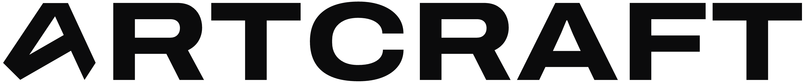
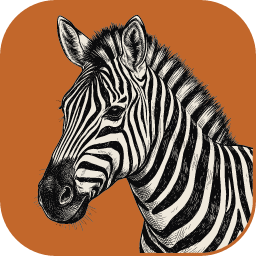
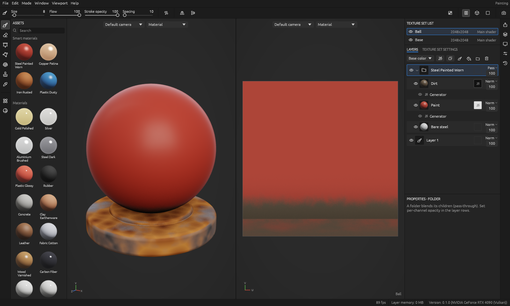
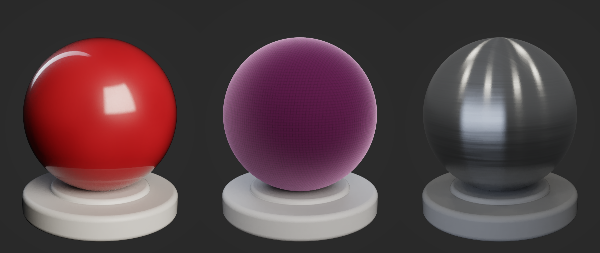
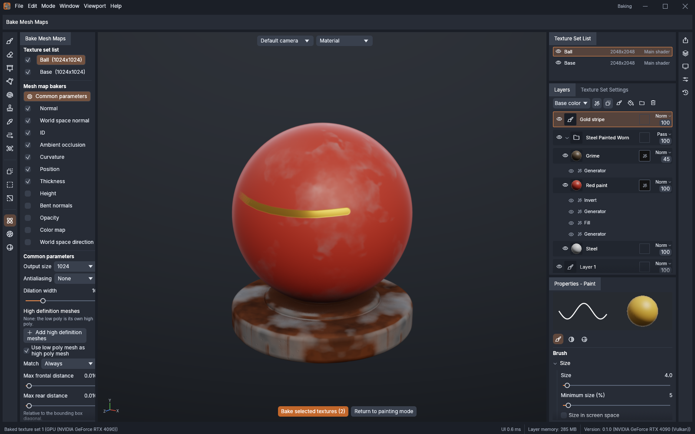
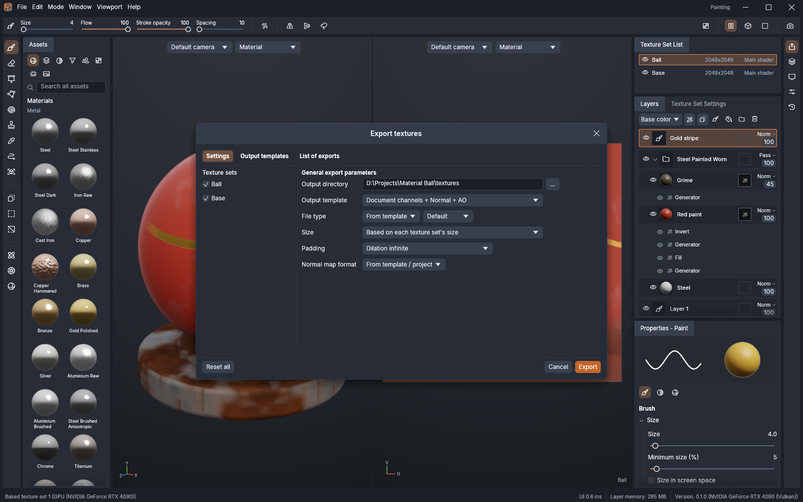
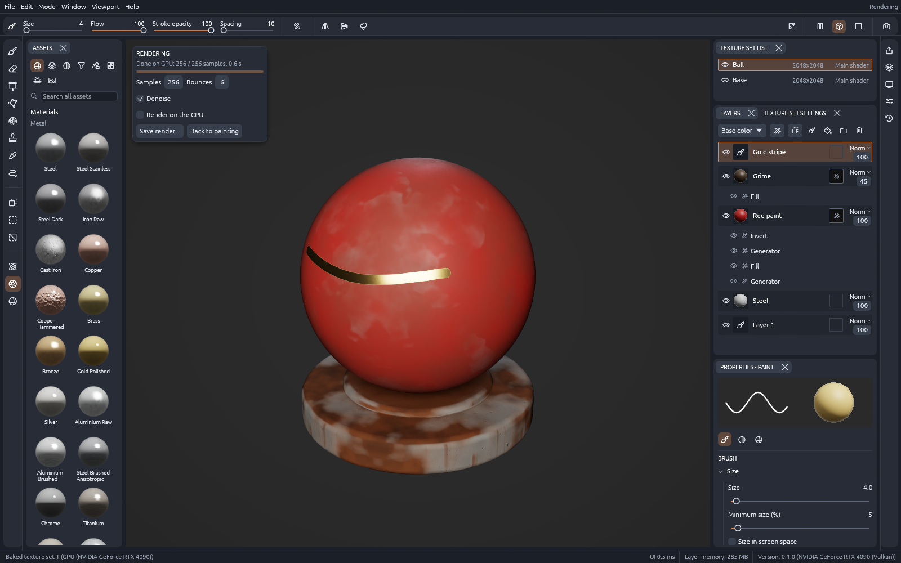
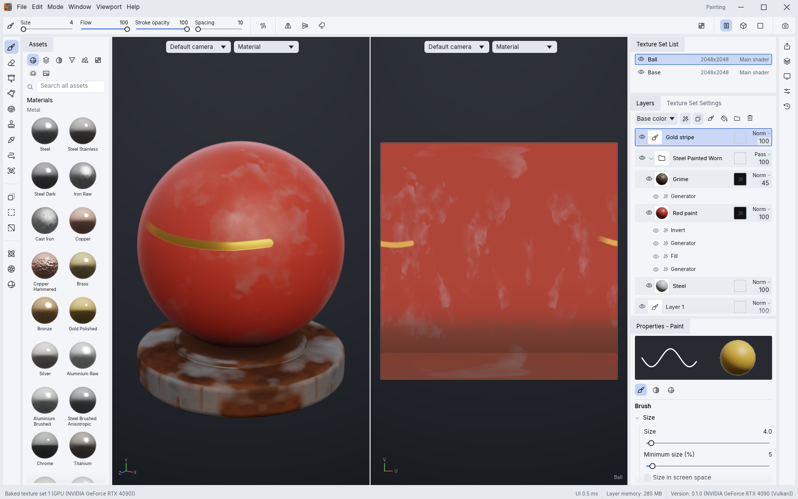
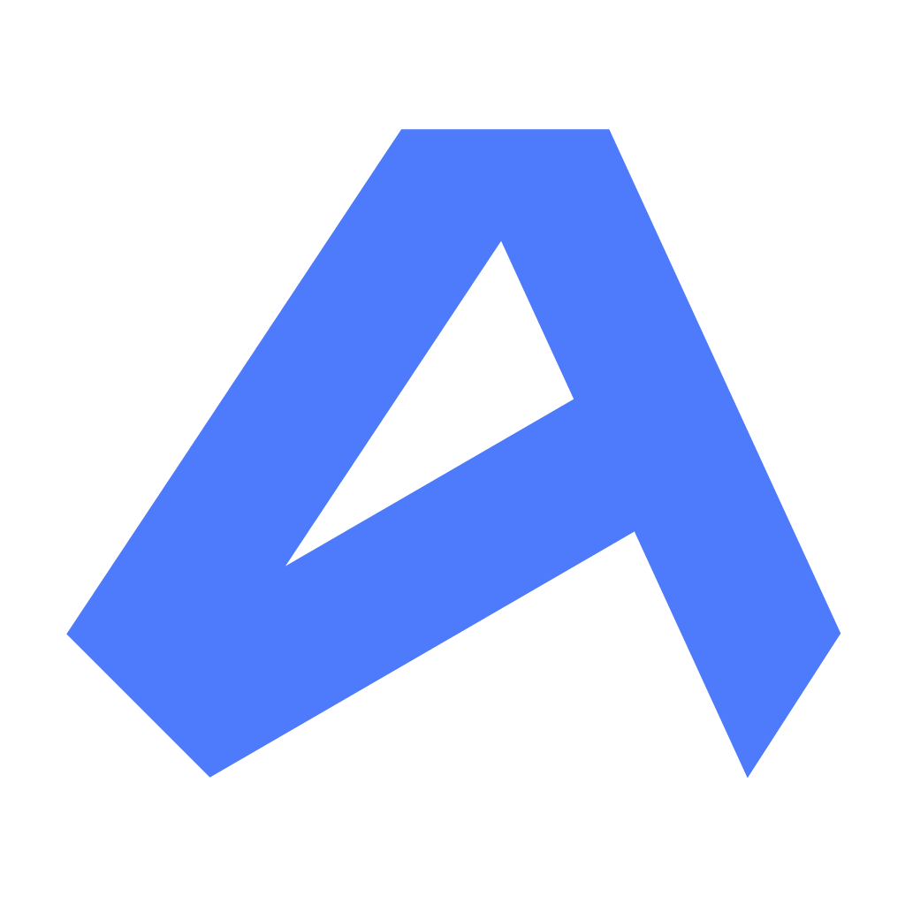

<p align="center">
  <a href="https://getartcraft.com/">
    <picture>
      <source media="(prefers-color-scheme: dark)" srcset="docs/brand/artcraft-logo-white.png">
      
    </picture>
  </a>
</p>

<p align="center">
  
</p>

<h1 align="center">TextureCraft</h1>

<p align="center">
  <b>3D texture painting; an open-source, clean-room reimplementation of Adobe Substance 3D Painter, rebuilt in pure Rust.</b><br>
  Paint PBR materials straight onto your models in layers with masks, bake mesh maps,<br>
  drive smart materials from them, and export textures for any engine. Open source, offline, and yours.
</p>

<p align="center">
  
  
  
  
</p>

<p align="center">
  <a href="https://discord.gg/artcraft"></a>
</p>

<p align="center">
  <a href="https://getartcraft.com/apps/texturecraft"><b>TextureCraft on getartcraft.com</b></a> ·
  <a href="https://getartcraft.com/">ArtCraft</a> ·
  <a href="https://getartcraft.com/apps">All Crafting Apps</a>
</p>

<br>

<p align="center">
  
  <br>
  <sub>The workspace: asset shelf, 3D viewport, 2D UV view, texture sets, layer stack and properties.</sub>
</p>

> [!NOTE]
> **ArtCraft is a community of artists from all walks of life.** Painters, sculptors, game
> artists, photographers, filmmakers, illustrators, designers, hobbyists, and people who picked up
> a stylus last week. If you make things, you belong here. **[Come say hi on Discord](https://discord.gg/artcraft).**

<p align="center">
  <a href="#features">Features</a> ·
  <a href="#paint-in-3d">Painting</a> ·
  <a href="#layers-masks-and-smart-materials">Layers</a> ·
  <a href="#files-and-texture-sets">Files</a> ·
  <a href="#bake-and-export">Bake and export</a> ·
  <a href="#the-viewport">Viewport</a> ·
  <a href="#built-for-agents">Agents</a> ·
  <a href="#get-started">Get started</a> ·
  <a href="#downloads">Downloads</a> ·
  <a href="#the-crafting-apps">Crafting Apps</a> ·
  <a href="https://discord.gg/artcraft">Discord</a>
</p>

<br>

<table>
  <tr>
    <td width="25%" valign="top">
      <h3>🎨 Familiar by design</h3>
      Texture sets, a layer stack with per-channel blending, masks and generators, the tool shelf, the 3D and 2D views: everything sits where a Painter user expects it.
    </td>
    <td width="25%" valign="top">
      <h3>⚡ Native and fast</h3>
      A tiled, copy-on-write texel engine on every CPU core and a wgpu viewport (Vulkan, Metal, DX12, WebGPU). No Electron, no web view, no waiting.
    </td>
    <td width="25%" valign="top">
      <h3>🧵 Seamless by construction</h3>
      Brush stamps live on the 3D surface, so strokes flow across UV seams, and the camera's visibility keeps paint off the back of your model.
    </td>
    <td width="25%" valign="top">
      <h3>🤖 Agent-ready</h3>
      Every action is a command, so you can drive the same engine from the UI, the CLI, a JSON control channel or an MCP server.
    </td>
  </tr>
</table>

## Features

### Paint in 3D

- **Brushes** with size, flow, stroke opacity, spacing, hardness, angle and follow path; size,
  angle, flow and position jitter; tangent or camera alignment, angle fade, backface culling, lazy
  mouse, X/Y/Z mirror symmetry and pen pressure. **67 procedural brush alphas** in their own shelf
  tab, or any imported image as the alpha.
- **Tools:** paint, eraser, **projection** with image stencils (hold S to move, turn and scale the
  stencil), polygon fill (triangle, UV island or the whole mesh), **path** and **lasso fill**, a
  **particle brush**, **smudge**, **clone** (V + click sets the source), color picker, Shift+click
  straight lines, and painting directly in the **2D UV view**.
- **Geometry decals:** drop an image on the surface, then move, scale and turn its frame; it stays
  an editable fill layer.
- **Quick mask** (Y): paint a temporary mask (U to edit, Ctrl+Shift+I to invert) that protects
  everything outside it while you paint.
- **Every channel at once:** base color, metallic, roughness, height, normal, emissive, opacity,
  ambient occlusion and specular level, plus clear coat, sheen, anisotropy, subsurface scattering
  and transmission, each toggled per stroke, the way Painter's material properties work.

### Layers, masks and smart materials

- **Paint, fill, folder and instance layers** with **32 blend modes per channel** (Normal through
  Normal map detail), per-channel opacity, visibility, color tags, drag-and-drop reordering,
  duplicate, group, flatten, cut, copy and paste across texture sets.
- **Filters and content effects** on any layer or mask: **18 filters** (HSL, levels,
  contrast/luminosity, color balance, gradient map, posterize, clamp, invert, threshold, blur,
  directional and slope blur, sharpen, warp and four material finishes), fills and paint.
  **Anchor points** record the stack at a layer so masks and fills higher up can react to it.
- **Masks** with a white or black background and a stack of effects: painted strokes, fills,
  **mesh-map generators** (edge wear, dirt, thin areas, curvature, AO, position and direction
  gradients, all with world-space noise), filters, ID color selection and compare. Alt+click a
  mask to view it alone.
- **Fill layers** take uniform values, **22 procedurals** (clouds, cells, grunge, scratches, wood
  grain, bricks, fabric weave, leather grain, marble veins, Voronoi, paint chips…) or your own
  **images**, through UV, tri-planar, planar, spherical, cylindrical or decal projection.
- **48 materials** (metals from measured reflectance, car paint, brushed anisotropic steel,
  velvet, skin, wax, glass, woods, stone, plastics, fabric, leather, ceramic), **17 smart
  materials** (rusted iron, worn paint, oxidized copper, bronze statue, weathered wood, mossy
  brick…) and **10 smart masks**, all procedural, so they work at any resolution. Drag them from
  the tabbed, searchable shelf onto the layer stack or straight onto the model.
- **Your own library:** right-click a layer or folder, choose *Create smart material*, and it
  appears under *My smart materials*, pixels and images included.

<p align="center">
  
  <br>
  <sub>Car paint (clear coat), velvet (sheen) and brushed steel (anisotropy), path traced on the GPU by <code>texturecraft-cli render</code>.</sub>
</p>

### Files and texture sets

- **Open** glTF/GLB, FBX (binary and ASCII), COLLADA, **USD** (usda, usdc, usdz), **Alembic**,
  OBJ, PLY and STL, or a built-in mesh; UVs are generated when a mesh has none. Reimport a changed
  mesh and your painted strokes stay on the surface.
- **UDIM / UV tiles:** detected on import or switched on later, with a resolution per tile and one
  texture per tile on export (`$udim`).
- **Texture sets** from 128 to 8192 px per material, resampled when you change them, with 21
  channel types to add or remove.
- **Projects** are a single `.tcraft` file: the mesh, every layer (sparse and lossless), baked maps
  and imported images. **Project templates** start new work from a saved setup.

### Bake and export

- **Bake mesh maps** on the GPU (ray traced, about 12× the CPU path) or on every CPU core: ambient
  occlusion, curvature, thickness, world-space normal, position, ID, bent normals, opacity, color
  and direction maps, and normal and height maps from high-poly meshes, with a cage, ray distances
  and matching by mesh name.
- **Export presets** for glTF PBR Metal Roughness, Unreal Engine (packed), Unity HDRP (mask map),
  Unity Standard, Blender (Principled BSDF), separate maps, mesh maps and document channels, in
  PNG, JPEG, TGA, TIFF, BMP, WEBP, EXR or HDR at 8, 16 or 32 bits, with UV padding, size
  override and OpenGL or DirectX normals.
- **Output template editor:** build your own presets with per-channel packing and converted maps,
  and share them as JSON.
- **Mesh export** to OBJ, textured GLB (with clear coat and sheen) and USD.

<p align="center">
  
  
</p>

### The viewport

- Physically based shading (metallic/roughness or specular/glossiness) with clear coat, sheen,
  anisotropy, subsurface scattering, transmission and parallax occlusion; image-based lighting from
  six procedural studio and outdoor environments or **your own HDR/EXR panoramas**; ACES or linear
  tone mapping, key-light shadows, bloom, vignette, sharpen, grain, **depth of field** and
  **saved cameras** (also imported from glTF).
- **Rendering mode** (F10): a progressive, **path-traced** view of your textures with multi-bounce
  light, environment importance sampling, a denoiser and one-click PNG save, traced on the GPU
  (compute shaders, about 25× the CPU tracer, desktop and WebGPU) or on the CPU.
- View any channel, any baked mesh map, or a UV checker; Alt+drag to orbit, middle-drag to pan,
  wheel to zoom, F to frame, M / C / B to cycle views.

<p align="center">
  
</p>

### Interface

- A modern look in **four brightness levels** (dark, medium dark, medium light and light) with
  **seven accent colors**, set in Settings › Interface.
- **Dockable, tabbed and floating panels**, saved layouts, and panels that reopen where you closed
  them.
- A **shortcut editor** with conflict detection, and every shortcut shown in its tooltip.
- **9 languages:** English, French, German, Spanish, Portuguese, Italian, Japanese, Chinese and
  Korean, switchable live.
- **In the browser:** the same app compiled to WebAssembly, on WebGPU or WebGL2, with touch
  navigation and project open, save and download.

<p align="center">
  
</p>

## Built for agents

Everything you can do in the window, an agent can do too:

- **CLI:** `texturecraft-cli new builtin:material_ball out.tcraft`, `bake`, `export`, `render`,
  `run <command> <params>`, `commands`.
- **MCP server:** `texturecraft-cli mcp` gives Claude and other agents tools to create projects,
  add layers and masks, paint strokes, bake, export, render previews and inspect everything they
  changed.
- **Control channel:** launch the app with `--control <port>` to drive the running UI: run any
  command, invoke menu items, paint, and take screenshots.

See [`docs/control-protocol.md`](docs/control-protocol.md) for the full protocol and examples.

## Get started

You need a recent stable Rust toolchain (1.95 or newer).

```sh
git clone https://github.com/storytold/texturecraft
cd texturecraft
cargo run --release -p texturecraft
```

The app opens with a baked sample project. **File ▸ New project** starts from one of the built-in
meshes, a project template, or your own glTF, GLB, FBX, COLLADA, USD, Alembic, OBJ, PLY or STL
file (UVs are generated if the mesh has none). For the browser build, run `trunk serve` in
`apps/texturecraft-web`.

Run the tests with `cargo test --workspace --release`. The architecture is described in
[`docs/architecture.md`](docs/architecture.md), the plan and parity estimate in
[`ROADMAP.md`](ROADMAP.md), and contributor rules in [`AGENTS.md`](AGENTS.md).

## Downloads

The easiest way to install TextureCraft is from its page on the ArtCraft website:
**[getartcraft.com/apps/texturecraft](https://getartcraft.com/apps/texturecraft)**.

Technical users can grab builds from GitHub: the
[latest release](https://github.com/storytold/texturecraft/releases/latest) or
[all releases](https://github.com/storytold/texturecraft/releases).

| Windows | File |
|---|---|
| Installer (x64, x86, arm64) | `texturecraft-<version>-windows-<arch>.msi` |
| Portable (x64, x86, arm64) | `texturecraft-<version>-windows-<arch>-portable.zip` |

| macOS | File |
|---|---|
| Universal app (Apple silicon and Intel), signed and notarized | `texturecraft-<version>-macos-universal.dmg` |
| Command-line tools | `texturecraft-cli-<version>-macos-universal.zip` |

| Linux (x86_64, aarch64) | File |
|---|---|
| AppImage (any distribution) | `texturecraft-<version>-linux-<arch>.AppImage` |
| Debian, Ubuntu, Mint, Pop!_OS | `texturecraft-<version>-linux-<arch>.deb` |
| Fedora, openSUSE, RHEL | `texturecraft-<version>-linux-<arch>.rpm` |
| Flatpak bundle | `texturecraft-<version>-linux-<arch>.flatpak` |
| Plain archive | `texturecraft-<version>-linux-<arch>.tar.gz` |

| FreeBSD | File |
|---|---|
| x86_64 | `texturecraft-<version>-freebsd-x86_64.tar.gz` |

| Web (WebAssembly) | File |
|---|---|
| Static site to host or embed | `texturecraft-web-<version>.zip` |

## The Crafting Apps

TextureCraft is one of the **Crafting Apps**: free, open-source creative tools from the
[ArtCraft](https://getartcraft.com/) team, each written from scratch in Rust and each able to
stand on its own.

| | App | What it's for | Code | Learn more |
|:-:|---|---|---|---|
|  | **TextureCraft** | **3D texture painting · you are here** | [GitHub](https://github.com/storytold/texturecraft) | [Website](https://getartcraft.com/apps/texturecraft) |
|  | **PhotoCraft** | Image editing: layers, masks, type and real PSD files | [GitHub](https://github.com/storytold/photocraft) | [Website](https://getartcraft.com/apps/photocraft) |
|  | **VectorCraft** | Vector illustration | [GitHub](https://github.com/storytold/vectorcraft) | [Website](https://getartcraft.com/apps/vectorcraft) |
|  | **FilmCraft** | Video editing, color and sound | [GitHub](https://github.com/storytold/filmcraft) | [Website](https://getartcraft.com/apps/filmcraft) |
|  | **LightCraft** | Photo library and raw development | [GitHub](https://github.com/storytold/lightcraft) | [Website](https://getartcraft.com/apps/lightcraft) |
|  | **PdfCraft** | Reading, organizing and protecting PDFs | [GitHub](https://github.com/storytold/pdfcraft) | [Website](https://getartcraft.com/apps/pdfcraft) |
|  | **EffectCraft** | Motion graphics and visual effects | [GitHub](https://github.com/storytold/effectcraft) | [Website](https://getartcraft.com/apps/effectcraft) |
|  | **DesignCraft** | Page layout and publishing | [GitHub](https://github.com/storytold/designcraft) | [Website](https://getartcraft.com/apps/designcraft) |
|  | **GridCraft** | Spreadsheets and data | [GitHub](https://github.com/storytold/gridcraft) | [Website](https://getartcraft.com/apps/gridcraft) |

And [**ArtCraft**](https://getartcraft.com/) itself, our AI image and video studio for artists who want real control.

<br>

<p align="center">
  <a href="https://discord.gg/artcraft"></a>
</p>

<h3 align="center">Come make things with us</h3>

<p align="center">
  Our Discord is where artists of every kind hang out: people who paint, sculpt, model, shoot, draw,
  cut film, set type, and people still figuring out what they like to make. Share what you're
  working on, ask for help, tell us what's broken, or tell us what you wish these tools could do.
  Whatever your medium and however long you've been at it, you're welcome here.
</p>

<p align="center">
  <a href="https://discord.gg/artcraft"><b>discord.gg/artcraft</b></a> ·
  <a href="https://getartcraft.com/">getartcraft.com</a> ·
  <a href="https://getartcraft.com/apps">The Crafting Apps</a> ·
  <a href="https://getartcraft.com/apps/texturecraft">TextureCraft</a>
</p>

## License and credits

TextureCraft is dual-licensed under [MIT](LICENSE-MIT) or [Apache-2.0](LICENSE-APACHE), at your option.
Copyright (c) 2026 ArtCraft Team and the TextureCraft contributors. Required notices are in [NOTICE](NOTICE).

Bundled fonts, icons, images and other assets keep their own open licenses; each one is listed
with its author, source and license in [ATTRIBUTION.md](ATTRIBUTION.md).

Every material, environment, brush alpha and mesh shown is generated procedurally by TextureCraft
itself; no third-party textures or models appear in the screenshots.

The ArtCraft name, wordmark and logos in [`docs/brand/`](docs/brand/) are trademarks of the
ArtCraft Team and are not covered by this license. They may be used only unmodified, and only as
part of this repository and TextureCraft, under [`docs/brand/LICENSE-brand.txt`](docs/brand/LICENSE-brand.txt).
Forks and modified versions must remove them.

<sub>Adobe, Substance 3D Painter, Photoshop, Illustrator, Premiere Pro, Lightroom, Acrobat, After Effects and InDesign are trademarks or registered trademarks of Adobe Inc. in the United States and/or other countries. TextureCraft is an independent, open-source project and is not affiliated with, sponsored by or endorsed by Adobe Inc.; these names are used only to describe the workflows it is compatible with.</sub>

<p align="center">
  <a href="https://getartcraft.com/"></a><br>
  <sub>Made by the <a href="https://getartcraft.com/">ArtCraft</a> team and community.</sub>
</p>
